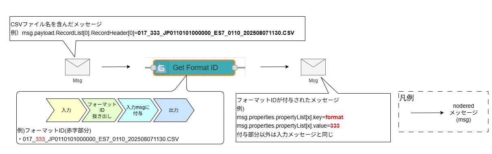
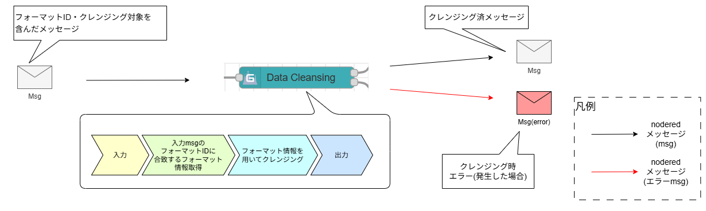
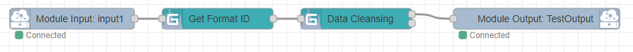
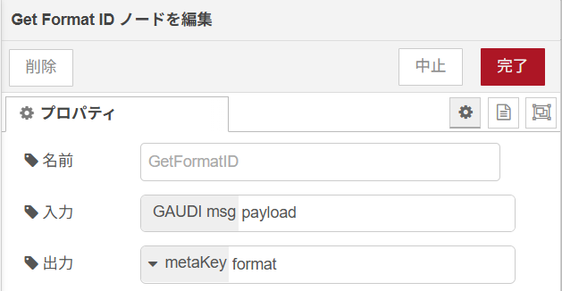
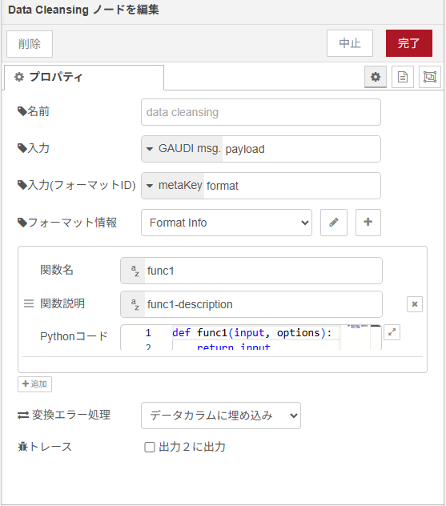
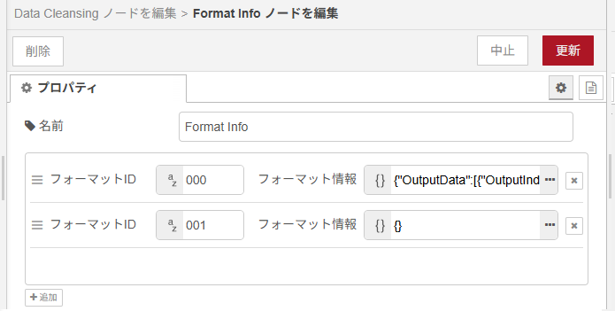
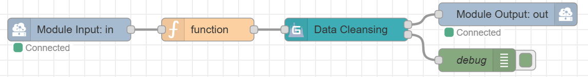
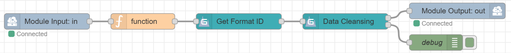

# node-red-datacleansing

## 目次

* [概要](#概要)
* [機能](#機能)
* [ノードの設定](#ノードの設定)
  * [環境変数](#環境変数)
  * [コンテナーの作成オプション Create Option](#コンテナーの作成オプション-create-option)
* [ノードライブラリの説明](#ノードライブラリの説明)
  * [Get Format ID](#Node-Specification-get-format-id)
  * [Data Cleansing](#Node-Specification-data-cleansing)
    * [Format Info仕様](#format-info仕様)
    * [定義済みの変換関数](#定義済みの変換関数)
    * [ユーザ定義変換関数要求仕様](#ユーザ定義変換関数要求仕様)
    * [変換エラー処理仕様](#変換エラー処理仕様)
    * [トレース出力仕様](#トレース出力仕様)
    * [使用例1](#使用例1-1)
    * [使用例2](#使用例2-1)
    * [使用例3](#使用例3)
* [ログ出力内容](#ログ出力内容)
  * [Get Format ID](#log-get-format-id)
  * [Data Cleansing](#log-data-cleansing)
* [エラー時動作一覧](#エラー時動作一覧)
  * [Get Format ID](#error-get-format-id)
  * [Data Cleansing](#error-data-cleansing)
* [Feedback](#feedback)
* [LICENSE](#license)

## 概要

node-red-datacleansingは、下記処理を行うNode-REDのカスタムノードです。

## 機能

入力データの抽出・変換を行う機能。  
以下のノードを含む。

* Get Format ID GAUDI 標準メッセージの先頭レコードの RecordHeader の先頭カラムから  
GAUDI標準CSVファイル命名規則(※)のフォーマットID相当部分を抽出する。  
※GAUDI標準CSVファイル命名規約:  
&emsp; 「送信先No（英数字3桁）_フォーマットNo（英数字3-4桁）_国コード（英数字2桁）  
&emsp; +会社コード（英数字2桁）+工場・棟コード（英数字3桁）+データ種別（英数字3桁）  
&emsp; +フリーエリア（英数字5桁）_タイムスタンプ等の可変データ.csv」の形式  


* Data Cleansing メッセージに付与されたフォーマット情報を元に入力データのクレンジング（フィルタリング／変換）を行う。  


各ノードを組み合わせて、  
入力データに対するフォーマット情報の付与とクレンジング処理を下記のようなシンプルなフローで実装可能。  


## ノードの設定

### 環境変数

#### 環境変数の値

(なし)

### コンテナーの作成オプション Create Option

#### コンテナーの作成オプション Create Option の値

(なし)

## ノードライブラリの説明

<a id="Node-Specification-get-format-id"></a>

### Get Format ID

#### 機能概要

GAUDI 標準メッセージの先頭レコードの RecordHeader の先頭カラムから  
GAUDI標準CSVファイル命名規則のフォーマットID相当部分を抽出する。

#### プロパティ



| プロパティ | Type                 | Required | Conditions      | Default              | Description                                                                                                             |
| ---------- | -------------------- | -------- | --------------- | -------------------- | ----------------------------------------------------------------------------------------------------------------------- |
| 名前       | textbox              |          |                 |                      | ノードの表示名を設定。                                                                                                  |
| 入力       | selectlist & textbox | 〇       | [GAUDI msg.]    | GAUDI msg. & payload | GAUDI標準メッセージ形式データを保持するmsgオブジェクト下の要素名を指定。                                                |
| 出力       | selectlist & textbox | 〇       | [metaKey, msg.] | metaKey & format     | フォーマットIDの設定先。<br>metaKey：メタキー（メッセージプロパティ）として設定<br>msg.：msg オブジェクト下の要素に設定 |

#### 使用例1

入力メッセージからフォーマットIDを抽出し、メッセージプロパティに出力する。

[フロー構成]


  
[プロパティ]

| プロパティ | Value                |
| ---------- | -------------------- |
| 入力       | GAUDI msg. & payload |
| 出力       | metaKey & format     |

[入力メッセージ]

```json
{
  "payload": {
    "RecordList":[
      {
        "RecordHeader":["017_333_JP0110101000000_ES7_0110_202508071130.CSV","1"], 
        "RecordData":["1", "2", "3"]
      }
    ]
  }
}
```

[出力メッセージ]

```json
{
  "payload": {
    "RecordList":[
      {
        "RecordHeader":["017_333_JP0110101000000_ES7_0110_202508071130.CSV","1"], 
        "RecordData":["1", "2", "3"]
      }
    ]
  },
  "properties": {
    "PropertyList":[
      {
        "key":"format", 
        "value":"333"
      }
    ]
  }
}
```

#### 使用例2

入力メッセージからフォーマットIDを抽出し、msgオブジェクト下の要素に出力する。

[フロー構成]

使用例1と同様

[プロパティ]

| プロパティ | Value                |
| ---------- | -------------------- |
| 入力       | GAUDI msg. & payload |
| 出力       | msg. & format        |

[入力メッセージ]

```json
{
  "payload": {
    "RecordList":[
      {
        "RecordHeader":["017_334_JP0110101000000_ES7_0110_202508071130.CSV","1"], 
        "RecordData":["1", "2", "3"]
      }
    ]
  }
}
```

[出力メッセージ]

```json
{
  "payload": {
    "RecordList":[
      {
        "RecordHeader":["017_334_JP0110101000000_ES7_0110_202508071130.CSV","1"], 
        "RecordData":["1", "2", "3"]
      }
    ]
  },
  "format": "334"
}
```

<a id="Node-Specification-data-cleansing"></a>

### Data Cleansing

#### 機能概要

  メッセージに付与されたフォーマット情報を元に入力データのクレンジング（フィルタリング／変換）を行う。

#### プロパティ



| プロパティ               | Type                     | Required | Conditions                                                                                                | Default                                    | Description                                                                                                                                                   |
| ------------------------ | ------------------------ | -------- | --------------------------------------------------------------------------------------------------------- | ------------------------------------------ | ------------------------------------------------------------------------------------------------------------------------------------------------------------- |
| 名前                     | textbox                  |          |                                                                                                           |                                            | ノードの表示名を設定。                                                                                                                                        |
| 入力                     | selectlist & <br>textbox | 〇       | [GAUDI msg., msg.]                                                                                        | GAUDI msg. & <br>payload                   | クレンジング対象データ。<br>GAUDI msg.：msg オブジェクト下の要素の<br>&emsp; GAUDI 標準形式データを対象<br>msg.：msg オブジェクト下の要素の配列データを対象   |
| 入力(フォーマットID)     | selectlist & <br>textbox | 〇       | [metaKey, msg.]                                                                                           | metaKey & <br>format                       | フォーマット情報から引き当てするフォーマットIDを<br>設定する。<br>metaKey：メタキー（メッセージプロパティ）として設定<br>msg.：msg オブジェクト下の要素に設定 |
| フォーマット情報         | グローバル設定           | 〇       |                                                                                                           |                                            | 引き当てするFormat Infoのグローバル設定を選択する。<br>詳細は、 [Format Info仕様](#format-info仕様) を参照。                                                  |
| ユーザ定義変換関数リスト | editablelist             |          |                                                                                                           |                                            | ユーザ定義の変換関数。                                                                                                                                        |
| &emsp; 関数名            | selectlist & <br>textbox | △        | ユーザ定義変換関数リスト項目追加時必須<br>Python コード側に<br>同名の関数を定義する必要がある<br>[文字列] | 文字列 & <br>func1                         | ユーザ定義変換関数名を指定。<br>フォーマット情報に設定する関数名を記述する。                                                                                  |
| &emsp; 関数説明          | selectlist & <br>textbox |          | [文字列]                                                                                                  | 文字列 & <br>func1-description             | ユーザ定義変換関数の説明文を記述する。                                                                                                                        |
| &emsp; Python コード     | editor                   | △        | ユーザ定義変換関数リスト項目追加時必須<br>Pythonの関数として<br>実行可能なコードを記述する必要がある      | def func1(input, options):<br>return input | ユーザ定義変換関数を記述するpythonエディタ。<br>詳細は、[ユーザ定義変換関数要求仕様](#ユーザ定義変換関数要求仕様) を参照。                                    |
| 変換エラー処理           | selectlist               | 〇       | [データカラムに埋め込み, <br>レコードをエラー出力, <br>メッセージをエラー出力]                            | データカラムに埋め込み                     | 変換に失敗したデータが存在する場合の出力方法を<br>選択する。<br>詳細は、[変換エラー処理仕様](#変換エラー処理仕様) を参照。                                    |
| トレース                 | checkbox                 |          |                                                                                                           | チェックなし                               | 詳細ログを出力2に出力する。<br>詳細は、[トレース出力仕様](#トレース出力仕様) を参照。                                                                         |

##### Format Info仕様

フォーマットIDとそれに対応するフォーマット情報を設定する。Data Cleansingから設定する。

###### プロパティ



| プロパティ              | Type                 | Required | Conditions                               | Default      | Description                                                                                        |
| ----------------------- | -------------------- | -------- | ---------------------------------------- | ------------ | -------------------------------------------------------------------------------------------------- |
| 名前                    | textbox              |          |                                          | Format Info  | ノードの表示名を設定。                                                                             |
| フォーマット情報リスト  | editablelist         | 〇       |                                          |              | 設定するフォーマット情報。                                                                         |
| &emsp; フォーマットID   | selectlist & textbox | 〇       | [文字列]<br>空白設定不可<br>重複設定不可 | 文字列 & 000 | フォーマット情報リスト項目毎に必須。<br>入力のフォーマットIDと引き当てするフォーマットID。         |
| &emsp; フォーマット情報 | selectlist & editor  | 〇       | [JSON] <br>空白設定不可                  | JSON & {}    | フォーマット情報リスト項目毎に必須。<br>フォーマットID毎のフォーマット情報を記述するJSONエディタ。 |

###### フォーマット情報

| JSON Key                | Type                 | Required | Conditions                                               | Default | Description                                                                                                                                                                                                                                                                                                                                                         |
| ----------------------- | -------------------- | -------- | -------------------------------------------------------- | ------- | ------------------------------------------------------------------------------------------------------------------------------------------------------------------------------------------------------------------------------------------------------------------------------------------------------------------------------------------------------------------- |
| format                  | string               |          |                                                          |         | フォーマットID。                                                                                                                                                                                                                                                                                                                                                    |
| OutputData              | object array         | 〇       |                                                          |         | 出力データ情報。                                                                                                                                                                                                                                                                                                                                                    |
| &emsp; OutputIndex      | number or <br>string | 〇       | 1以上の整数もしくは"Property"<br>または"PropertyAddOnly" |         | 変換後データの出力先。<br>1以上の整数(出力データインデックス)：<br>&emsp; メッセージボディ(msg.payload)の指定インデックスに出力する。<br>"Property"：<br>&emsp; OutputNameで設定したメッセージプロパティに出力し、プロパティが既存の<br>&emsp; 場合は値を上書き<br>"PropertyAddOnly"：<br>&emsp; OutputNameで設定したメッセージプロパティが既存でない場合に出力する |
| &emsp; OutputName       | string               | △        | OutputIndex="Property"<br>または"PropertyAddOnly"時必須  |         | 出力先プロパティ名。                                                                                                                                                                                                                                                                                                                                                |
| &emsp; InputIndex       | number array         | 〇       | 1以上の整数の配列                                        |         | 変換前データの入力元。<br>1以上の整数配列(入力データインデックス)：<br>Data Cleansingノードの入力プロパティの指定インデックスを入力とする。                                                                                                                                                                                                                         |
| &emsp; Converters       | object array         | 〇       |                                                          |         | 変換情報。                                                                                                                                                                                                                                                                                                                                                          |
| &emsp; &emsp; Converter | string               | 〇       |                                                          |         | 変換関数名。定義済みの変換関数名またはユーザ定義変換関数名を指定する。<br>詳細は、[定義済みの変換関数](#定義済みの変換関数) を参照。                                                                                                                                                                                                                                |
| &emsp; &emsp; Enabled   | boolean              | 〇       | [true, false]                                            |         | 変換情報の有効/無効。<br>true：変換関数を適用する<br>false：変換関数を適用しない                                                                                                                                                                                                                                                                                    |
| &emsp; &emsp; Options   | 変換関数に依存       |          |                                                          |         | 変換オプションデータ。変換関数で必要な追加情報を指定する。                                                                                                                                                                                                                                                                                                          |

##### 定義済みの変換関数

Data Cleansingで定義済みの、デフォルトで使用可能な変換関数。

| 論理名                                | 物理名              | エイリアス名<br>(廃止予定) | 機能                                                                                                                                                                                                                                                                                                        | 入力                                                | オプション                                                                                                                                                                                                                                                                                                                                                                                                                    |
| ------------------------------------- | ------------------- | -------------------------- | ----------------------------------------------------------------------------------------------------------------------------------------------------------------------------------------------------------------------------------------------------------------------------------------------------------- | --------------------------------------------------- | ----------------------------------------------------------------------------------------------------------------------------------------------------------------------------------------------------------------------------------------------------------------------------------------------------------------------------------------------------------------------------------------------------------------------------- |
| 日時データ結合                        | UnionDate           |                            | 入力の３データをそれぞれ、<br>int 変換 →byte 分割 → 再連結した後に<br>年月・日時・分秒のデータとして連結した<br>日時データ文字列にする。<br>出力形式は、"YYYY/MM/DD hh:mm:ss"の形式となる。                                                                                                                 | [0]~[2]:２バイト INT                                | なし                                                                                                                                                                                                                                                                                                                                                                                                                          |
| 日時データ結合\_<br>swap              | UnionDateSwap       |                            | 入力の３データをそれぞれ、<br>int 変換 →byte 分割 →swap→ 再連結した後に<br>年月・日時・分秒のデータとして連結した<br>日時データ文字列にする。<br>出力形式は、"YYYY/MM/DD hh:mm:ss"の形式となる。                                                                                                            | [0]~[2]:２バイト INT                                | なし                                                                                                                                                                                                                                                                                                                                                                                                                          |
| 日時データ結合\_<br>12 桁形式         | UnionDateF12        |                            | 入力の３データをそれぞれ、<br>int 変換 →byte 分割 → 再連結した後に<br>年月・日時・分秒のデータとして連結した<br>日時データ文字列にする。<br>出力形式は、"YYMMDDhhmmss"の形式となる。                                                                                                                        | [0]~[2]:２バイト INT                                | なし                                                                                                                                                                                                                                                                                                                                                                                                                          |
| 日時データ結合\_<br>12 桁形式 swap    | UnionDateF12Swap    |                            | 入力の３データをそれぞれ、<br>byte 分割 →swap 再連結した後に<br>年月・日時・分秒のデータとして連結した<br>日時データ文字列にする。<br>出力形式は、"YYMMDDhhmmss"の形式となる。                                                                                                                              | [0]~[2]:２バイト INT                                | なし                                                                                                                                                                                                                                                                                                                                                                                                                          |
| 日付データ<br>書式変換                | DateFormat          |                            | 入力の日付形式文字列を日付データに変換後、<br>指定された書式の文字列に再変換する。<br>（Date2DateF12 の下位関数）<br>※ fff部は、マイクロ秒として取り込み、出力する。                                                                                                                                        | [ 日付形式文字列 ]<br>"YYYY/MM/DD hh:mm:ss.fff"形式 | [ 変換書式 ]<br>変換書式：<br>&nbsp; Python の書式形式で指定。省略可能。<br>デフォルト＝"%y%m%d%H%M%S"                                                                                                                                                                                                                                                                                                                        |
| 日付データ<br>書式変換\_<br>12 桁形式 | Date2DateF12        |                            | 入力の日付形式文字列を日付データに変換後、<br>"YYMMDDhhmmss"の形式の文字列に再変換する。                                                                                                                                                                                                                    | [ 日付形式文字列 ]<br>"YYYY/MM/DD hh:mm:ss.fff"形式 | なし                                                                                                                                                                                                                                                                                                                                                                                                                          |
| ISO時刻<br>形式変換                   | NativeTimeToISOTime |                            | タイムゾーン情報を持たない非ISO形式日時文字列を<br>オプションで指定したタイムゾーンの<br>時刻値と書式に変換する。<br>%z出力による時差表記部分は、<br>基本的に"+0000"の形式となる。<br>（"+00:00"の形式ではない）<br>出力データタイムゾーンにUTCを指定した場合、<br>時差表記は、"+0000"ではなく、"Z"となる。 | 非ISO形式日時文字列<br>（タイムゾーン情報なし）     | 長さが4の配列形式で記載する。<br>&nbsp; [0]: 入力データタイムゾーン<br>&nbsp; [1]: 入力データフォーマット<br>&nbsp;（Pythonフォーマット形式。<br>&nbsp; 例："%Y-%m-%d %H:%M:%S.%f"）<br>&nbsp; [2]: 出力データタイムゾーン<br>&nbsp;（省略可能。デフォルト＝"UTC"）<br>&nbsp; [3]: 出力データフォーマット<br>&nbsp;（Pythonフォーマット形式。省略可能。<br>&nbsp;&nbsp;デフォルト＝<br>&nbsp;&nbsp;"%Y-%m-%dT%H:%M:%S.%f%z"） |
| 書式変換                              | Format              |                            | 入力データ配列をオプションで指定した<br>書式に変換して文字列化する。                                                                                                                                                                                                                                        | [0]~[N]:数値・文字列                                | [ 変換書式 ]<br>変換書式： Pythonの書式形式で指定。<br>※推奨の書式：<br>&nbsp; &nbsp; {:書式}を<br>&nbsp; &nbsp; 入力の配列データを順にセット<br>※Python書式に従うが、<br>&nbsp; &nbsp; インデックス指定時は<br>&nbsp; &nbsp; ０オリジンの為、注意が必要。                                                                                                                                                                    |
| 単位変換                              | Operation           |                            | 入力データと Options 配列の先頭データを<br>float 変換し、掛け合わせたものを出力する。                                                                                                                                                                                                                       | INT                                                 | [変換倍率]<br>変換倍率：入力に掛け合わせる数値。                                                                                                                                                                                                                                                                                                                                                                              |
| 除算                                  | Division            |                            | 10進データをオプションの除数で除算する。                                                                                                                                                                                                                                                                    | 数値                                                | [除数]                                                                                                                                                                                                                                                                                                                                                                                                                        |
| 最大値取得                            | Max                 |                            | 入力データ列から最大値を取得する。                                                                                                                                                                                                                                                                          | [ 数値配列 ]                                        | なし                                                                                                                                                                                                                                                                                                                                                                                                                          |
| 最小値取得                            | Min                 |                            | 入力データ列から最小値を取得する。                                                                                                                                                                                                                                                                          | [ 数値配列 ]                                        | なし                                                                                                                                                                                                                                                                                                                                                                                                                          |
| 上位・<br>下位バイト<br>入れ替え      | Swap                |                            | 2byte16進データの上位・下位バイトを入れ替える。<br>４桁未満の場合は、前方を０埋めする。                                                                                                                                                                                                                     | １６進文字列（４桁）                                | なし                                                                                                                                                                                                                                                                                                                                                                                                                          |
| 固定値設定                            | SetValue            |                            | Options で指定された値を設定する。                                                                                                                                                                                                                                                                          | なし                                                | [設定値]                                                                                                                                                                                                                                                                                                                                                                                                                      |
| フラグ反転                            | RevertFlag          |                            | 0/1 フラグを反転する。<br>（入力値が０の場合１を返し、それ以外は０を返す）                                                                                                                                                                                                                                  | BOOLEAN/INT                                         | なし                                                                                                                                                                                                                                                                                                                                                                                                                          |
| 10進(2byte)→<br>2進変換               | DecToBit            |                            | 10進(2byte)データを2進データに変換。                                                                                                                                                                                                                                                                        | INT                                                 | なし                                                                                                                                                                                                                                                                                                                                                                                                                          |
| 2進(1byte)→<br>10進変換               | BitToDec            | bit_to_dec                 | 2 進データを 10 進データに変換。（1byte 分）                                                                                                                                                                                                                                                                | 2進数（文字列）                                     | なし                                                                                                                                                                                                                                                                                                                                                                                                                          |
| 16進(2byte)→<br>10進変換              | HexToDec            |                            | 16 進データ(2byte)を 10 進データに変換。                                                                                                                                                                                                                                                                    | 16進数（文字列）                                    | なし                                                                                                                                                                                                                                                                                                                                                                                                                          |
| 10進→<br>16進変換                     | DecToHex            | dec_to_hex                 | 10 進データを 16 進データに変換。（2byte）                                                                                                                                                                                                                                                                  | ２バイト INT                                        | なし                                                                                                                                                                                                                                                                                                                                                                                                                          |
| 16進(2byte)→<br>2進変換               | HexToBit            |                            | 16 進(2byte)データを2進データに変換。                                                                                                                                                                                                                                                                       | 16進数（文字列）                                    | なし                                                                                                                                                                                                                                                                                                                                                                                                                          |
| 2進(1byte)→<br>16進変換               | BitToHex            |                            | 2 進データを 16 進データに変換。（1byte 分）                                                                                                                                                                                                                                                                | 2進数（文字列）                                     | なし                                                                                                                                                                                                                                                                                                                                                                                                                          |
| ID 計算                               | two_word_to_hour    |                            | 上位・下位 byte データを 16 進文字化後、<br>連結して int(2byte)化、msec から hour 単位に変換。                                                                                                                                                                                                              | [２バイト INT, ２バイト INT]                        | なし                                                                                                                                                                                                                                                                                                                                                                                                                          |
| 文字連結                              | Join                | join                       | 文字のリストを連結し、１文字列にする。                                                                                                                                                                                                                                                                      | [ 文字配列 ]                                        | [結合セパレータ]<br>結合セパレータ：<br>　連結する文字列間に挿入する文字。<br>　省略時は、挿入しない。                                                                                                                                                                                                                                                                                                                        |
| 文字列抽出                            | Substring           | substring                  | 文字列から一部を抽出する。                                                                                                                                                                                                                                                                                  | 文字列                                              | [抽出開始位置, 抽出文字数]<br>抽出開始位置：<br>　切り出し開始位置。（1 ～）<br>　負値の場合、<br>　文字列末端からの文字数となる。<br>　省略時は、1。<br>抽出文字数：<br>　切り出し文字数。（1 ～）<br>　負値の場合、<br>　元文字列長と合算した値を<br>　抽出文字数とする。<br>　省略時は、末尾まで切り出し                                                                                                                   |
| 分割抽出                              | Split               | split                      | 文字列を指定セパレータで分解し、<br>指定位置のデータを抽出する。                                                                                                                                                                                                                                            | 文字列                                              | [セパレータ, 抽出位置]<br>セパレータ：<br>　文字の分解に使用する文字。省略不可。<br>抽出位置：<br>　分解した文字列の配列から<br>　抜き出す位置。（1 ～）                                                                                                                                                                                                                                                                      |
| スペース除去                          | Trim                | trim                       | 入力文字列全体のスペースを除去。                                                                                                                                                                                                                                                                            | 文字列                                              | なし                                                                                                                                                                                                                                                                                                                                                                                                                          |
| バイト分割数値<br>文字列化            | change_normal       |                            | int 変換 →byte 分割 → 再連結（文字列）                                                                                                                                                                                                                                                                      | INT                                                 | なし                                                                                                                                                                                                                                                                                                                                                                                                                          |
| バイト分割数値<br>文字列化swap        | change_normal_swap  |                            | int 変換 →byte 分割 →<br>byte スワップ → 再連結（文字列）                                                                                                                                                                                                                                                   | INT                                                 | なし                                                                                                                                                                                                                                                                                                                                                                                                                          |
| コードキー生成                        | CodeKey             |                            | 入力の１～３番目のデータをそれぞれ、<br>int 変換 →byte 分割 → 再連結し、<br>全てのデータを文字列として連結する。                                                                                                                                                                                            | [0]: INT<br>[1]~[3]:２バイト INT<br>[4]: INT        | なし                                                                                                                                                                                                                                                                                                                                                                                                                          |
| コードキー生成\_<br>swap              | CodeKeySwap         |                            | 入力の１～３番目のデータをそれぞれ、<br>int 変換 →byte 分割 →swap→ 再連結し、<br>全てのデータを文字列として連結する。                                                                                                                                                                                       | [0]: INT<br>[1]~[3]:２バイト INT<br>[4]: INT        | なし                                                                                                                                                                                                                                                                                                                                                                                                                          |

##### ユーザ定義変換関数要求仕様

###### 引数1

変換対象入力データ。  
フォーマット情報の入力インデックス数が１の場合は単独データ、  
フォーマット情報の入力インデックス数が２以上の場合は配列データが入力される。  

###### 引数2

変換オプションデータ。  
フォーマット情報の Options で指定された変換オプションデータが渡される。  
Options に指定されているデータの件数が１の場合は単独データ、２以上の場合は配列データで入力される。  

###### 戻り値

変換結果を返す。

###### 関数イメージ

```python
import math
# 入力値（リスト内の数値）を指定した options の桁数（小数点以下）に切り捨てる
def floor_data(input, options):
    def process_value(value):
        retValue = math.floor(float(value) * 10 ** options) / (10 ** options)
        if retValue < 0:
            retValue = retValue + (10 ** -options)
        return round(retValue, options)

    return [process_value(value) for value in input]
```

##### 変換エラー処理仕様

変換に失敗したデータが存在する場合、指定したオプションに従いメッセージに出力する。  
変換に失敗したデータのインデックス配列をconverrorindexプロパティにセットする。  
下記に定義済み変換関数Splitを使用し、2つの配列の分割後2つ目と3つ目を抽出する場合の例を示す。  

###### データカラムに埋め込み

出力1:変換に成功したデータと失敗したデータを出力する  
出力2:なし  

[入力メッセージ]

```json
{
  "payload": [["1,2,3","4,5,6"],["A,B,C","D,E,F"]],
  "format": "034"
}
```

[出力1のメッセージ]

```json
{
  "payload": [
    ["2", "6"],
    ["B", <エラー情報>]
  ],
  "format": "034",
  "converrorindex": [1]
}
```

[出力2のメッセージ]

なし

###### レコードをエラー出力

出力1:変換に成功したデータを出力する  
出力2:変換に失敗したデータを出力する  

[入力メッセージ]

```json
{
  "payload": [["1,2,3","4,5,6"],["A,B,C","D,E,F"]],
  "format": "034"
}
```

[出力1のメッセージ]

```json
{
  "payload": [
    ["2", "6"]
  ],
  "format": "034",
  "converrorindex": []
}
```

[出力2のメッセージ]

```json
{
  "payload": [
    ["B", <エラー情報>]
  ],
  "format": "034",
  "converrorindex": [0]
}
```

###### メッセージをエラー出力

  [変換が全て成功した場合]

  出力1:変換に成功したデータを出力する  
  出力2:なし

  [入力メッセージ]

  ```json
  {
    "payload": [["1,2,3","4,5,6"],["A,B,C","D,E,F"]],
    "format": "034"
  }
  ```

  [出力1のメッセージ]

  ```json
  {
    "payload": [
      ["2", "6"],
      ["B", "F"]
    ],
    "format": "034",
    "converrorindex": []
  }
  ```

  [出力2のメッセージ]

  なし

  [変換に失敗したデータが1つ以上存在する場合]

  出力1:なし  
  出力2:変換に成功したデータと失敗したデータを出力する

  [入力メッセージ]

  ```json
  {
    "payload": [["1,2,3","4,5,6"],["A,B,C","D,E,F"]],
    "format": "034"
  }
  ```

  [出力1のメッセージ]

  なし

  [出力2のメッセージ]

  ```json
  {
    "payload": [
      ["2", "6"],
      ["B", <エラー情報>]
    ],
    "format": "034",
    "converrorindex": [1]
  }
  ```

##### トレース出力仕様

トレース出力が有効化されている場合、トレース情報をtraceプロパティにセットし、出力２にメッセージ出力する。

[出力2のメッセージ]

```json
{
  "trace": [
    "=== Trace data START ===",
    <トレース情報１>,
    <トレース情報２>,
    ：
    "=== Trace data END ===",
  ]
}
```

#### 使用例1

msgオブジェクト下の要素の配列データの入力メッセージを、定義済み関数NativeTimeToISOTimeを使用してクレンジングを行う。

[フロー構成]



[プロパティ]

| プロパティ               | Value          |
| ------------------------ | -------------- |
| 入力                     | msg. & payload |
| 入力(フォーマットID)     | msg. & format  |
| フォーマット情報         | Format Info    |
| ユーザ定義変換関数リスト | 設定なし       |

[Format Info]

| プロパティ              | Value                      |
| ----------------------- | -------------------------- |
| 名前                    | Format Info                |
| フォーマット情報リスト  |                            |
| &emsp; フォーマットID   | 999                        |
| &emsp; フォーマット情報 | 下記[フォーマット情報]参照 |

[フォーマット情報]

```json
{
  "OutputData": [
    {
      "OutputIndex": 1,
      "OutputName": "",
      "InputIndex": [ 1 ],
      "Converters": [
        {
          "Converter": "NativeTimeToISOTime",
          "Enabled": true,
          "Options": [
            "UTC",
            "%A, %B %d, %Y %I:%M %p",
            "Asia/Tokyo",
            "%Y %B %d %A %I:%M:%S.%f%z"
          ]
        }
      ]
    }
  ]
}
```

[入力メッセージ]

```json
{
  "payload": [["Sunday, January 01, 2023 04:30 PM"]],
  "format": "999"
}
```

[出力メッセージ]

```json
{
  "payload": [["2023 January 02 Monday 01:30:00.000000+0900"]],
  "format": "999",
  "converrorindex": []
}
```

#### 使用例2

GAUDI標準形式の入力メッセージを、変換関数MyConverterを使用してクレンジングを行う。

[フロー構成]



[プロパティ]

| プロパティ               | Value                         |
| ------------------------ | ----------------------------- |
| 入力                     | GAUDI msg. & payload          |
| 入力(フォーマットID)     | metaKey & format              |
| フォーマット情報         | Format Info                   |
| ユーザ定義変換関数リスト |                               |
| &emsp; 関数名            | MyConverter                   |
| &emsp; 関数説明          | ","分割＋指定カラムデータ抽出 |
| &emsp; Python コード     | 下記[Pythonコード]参照        |
| 変換エラー処理           | データカラムに埋め込み        |

[Pythonコード]

```python
def MyConverter(input, options):
    return input.split(',')[options-1]
```

[Format Info]

| プロパティ              | Value                      |
| ----------------------- | -------------------------- |
| 名前                    | Format Info                |
| フォーマット情報リスト  |                            |
| &emsp; フォーマットID   | 333                        |
| &emsp; フォーマット情報 | 下記[フォーマット情報]参照 |

[フォーマット情報]

```json
{
  "OutputData": [
    {
      "OutputIndex": 1,
      "InputIndex": [ 1 ],
      "Converters": [
        {
          "Converter": "MyConverter",
          "Enabled": true,
          "Options": 2
        }
      ]
    }
  ]
}
```

[入力メッセージ]

```json
{
  "payload": 
    {
      "RecordList":[
        {
          "RecordHeader":["017_333_JP0110101000000_ES7_0110_202508071130.CSV","1"], 
          "RecordData":["1,2,3"]
        }
      ]
    },
  "properties": {"PropertyList":[{"key":"format", "value":"333"}]}
}
```

[出力メッセージ]

```json
{
  "payload": 
    {
      "RecordList":[
        {
          "RecordHeader":["017_333_JP0110101000000_ES7_0110_202508071130.CSV","1"], 
          "RecordData":["2"]
        }
      ]
    },
  "properties": 
    {
      "PropertyList":[
        {
          "key":"format", 
          "value":"333"
        }
      ]
    },
  "converrorindex": []
}
```

#### 使用例3

msgオブジェクト下の要素の配列データの入力メッセージを、変換関数MyConverterを使用してクレンジングを行う。  
2つの配列データそれぞれにクレンジングを行う。

[フロー構成]

使用例1と同様

[プロパティ]

| プロパティ               | Value                         |
| ------------------------ | ----------------------------- |
| 入力                     | msg. & payload                |
| 入力(フォーマットID)     | msg. & format                 |
| フォーマット情報         | Format Info                   |
| ユーザ定義変換関数リスト |                               |
| &emsp; 関数名            | MyConverter                   |
| &emsp; 関数説明          | ","分割＋指定カラムデータ抽出 |
| &emsp; Python コード     | 下記[Pythonコード]参照        |

[Pythonコード]

```python
def MyConverter(input, options):
    return input.split(',')[options-1]
```

[Format Info]

| プロパティ              | Value                      |
| ----------------------- | -------------------------- |
| 名前                    | Format Info                |
| フォーマット情報リスト  |                            |
| &emsp; フォーマットID   | 034                        |
| &emsp; フォーマット情報 | 下記[フォーマット情報]参照 |

[フォーマット情報]

```json
{
  "OutputData": [
    {
      "OutputIndex": 1,
      "InputIndex": [ 1 ],
      "Converters": [
        {
          "Converter": "MyConverter",
          "Enabled": true,
          "Options": 2
        }
      ]
    },
    {
      "OutputIndex": 2,
      "InputIndex": [ 2 ],
      "Converters": [
        {
          "Converter": "MyConverter",
          "Enabled": true,
          "Options": 3
        }
      ]
    }
  ]
}
```

[入力メッセージ]

```json
{
  "payload": [["1,2,3","4,5,6"],["A,B,C","D,E,F"]],
  "format": "034"
}
```

[出力メッセージ]

```json
{
  "payload": [
    ["2", "6"],
    ["B", "F"]
  ],
  "format": "034",
  "converrorindex": []
}
```

## ログ出力内容

<a id="log-get-format-id"></a>

### Get Format ID

| LogLevel | 出力概要                                                           |
| -------- | ------------------------------------------------------------------ |
| error    | フォーマットID取得失敗                                             |
| warn     | 無し                                                               |
| info     | メッセージ[受信/送信]                                              |
| debug    | プロパティ・フォーマットID                                         |
| trace    | メソッドの開始・終了<br>受信メッセージプロパティ<br>送信メッセージ |

<a id="log-data-cleansing"></a>

### Data Cleansing

| LogLevel | 出力概要                                                                                                                                                                                          |
| -------- | ------------------------------------------------------------------------------------------------------------------------------------------------------------------------------------------------- |
| error    | 出力メッセージ作成時発生エラー<br>pythonコード実行エラー<br>フォーマット情報タイプ不正<br>フォーマット情報取得失敗                                                                                |
| warn     | 無し                                                                                                                                                                                              |
| info     | テンポラリーフォルダー削除[成功/失敗]※<br>メッセージ[受信/送信]<br>クレンジング失敗※<br>[プロパティ/メタキー/フォーマットId]が無い※<br>[RecordList/ペイロード]が配列ではない※<br>フォーマット情報 |
| debug    | エラー変換処理オプション<br>トレースフラグ<br>再構築フラグ<br>アドインフォルダ再作成<br>フォーマット情報<br>pythonシェル                                                                          |
| trace    | メソッドの開始・終了<br>[受信/送信]メッセージ<br>取得処理中フォーマット情報<br>OutputDataが配列か                                                                                                 |

※例外も同時に出力

## エラー時動作一覧

<a id="error-get-format-id"></a>

### Get Format ID

| 分類                       | エラー内容                                                                                                   | 動作                                                                                                             | 出力ログレベル |
| -------------------------- | ------------------------------------------------------------------------------------------------------------ | ---------------------------------------------------------------------------------------------------------------- | -------------- |
| **ノードのプロパティ設定** | 必須項目未設定。                                                                                             | デプロイ時エディター上に警告が発生する。<br>警告無視しデプロイするとメッセージ受信時に例外出力、処理は中断する。 | error          |
| **メッセージ受信**         | プロパティ設定の"入力"に指定したメッセージプロパティが<br>GAUDI標準メッセージ形式でない場合。                | 例外出力。<br>ノード処理は中断する。                                                                             | error          |
| &emsp;                     | メッセージの先頭レコードのRecordHeaderの先頭カラムの値が<br>GAUDI標準CSVファイル命名規約に従っていない場合。 | 例外出力。<br>ノード処理は中断する。                                                                             | error          |

※ 出力した例外は、catchノードで受信可能。  

<a id="error-data-cleansing"></a>

### Data Cleansing

| 分類                       | エラー内容                                                                                                   | 動作                                                                                                                                                                                 | 出力ログレベル |
| -------------------------- | ------------------------------------------------------------------------------------------------------------ | ------------------------------------------------------------------------------------------------------------------------------------------------------------------------------------ | -------------- |
| **ノードのプロパティ設定** | 必須項目未設定。                                                                                             | Format Info更新時とデプロイ時エディター上に警告が発生する。                                                                                                                          |                |
| &emsp;                     | フォーマット情報がConditions制約違反またはType制約違反。                                                     | Format Info更新時とデプロイ時にエディター上に警告が発生する。<br>警告無視しデプロイするとメッセージ受信時に変換エラーが発生、<br>msg.errorにエラー情報出力する。処理は正常終了する。 | error          |
| &emsp;                     | ユーザー定義変換関数リスト上の関数名とPython コードの関数名の不一致。                                        | デプロイ時エディター上に警告が発生する。                                                                                                                                             | -              |
| **メッセージ受信**         | プロパティ設定の"入力(フォーマットID)"に指定したメッセージプロパティが、<br>受信したメッセージに存在しない。 | 例外出力。<br>ノード処理は中断する。                                                                                                                                                 | error          |
| &emsp;                     | 受信したメッセージで指定したフォーマットIDが<br>Format Infoノードに存在しない。                              | 例外出力。<br>ノード処理は中断する。                                                                                                                                                 | error          |
| &emsp;                     | プロパティ設定の"入力"で指定したメッセージ形式と<br>受信したメッセージ形式が一致しない。                     | 例外出力。<br>ノード処理は中断する。                                                                                                                                                 | error          |
| &emsp;                     | 参照ライブラリの取得エラー。                                                                                 | msg.errorにエラー情報出力。<br>ノード処理は正常終了する。                                                                                                                            | -              |
| &emsp;                     | ユーザ定義変換関数の読み込みエラー。                                                                         | msg.errorにエラー情報出力。<br>ノード処理は正常終了する。                                                                                                                            | -              |
| &emsp;                     | 変換関数実行中にエラー。                                                                                     | 変換エラー。<br>ノード処理は正常終了する。                                                                                                                                           | -              |
| **ノードの削除**           | ユーザ定義addin用テンポラリフォルダ削除失敗                                                                  | 例外出力。                                                                                                                                                                           | error          |

※ 出力した例外は、catchノードで受信可能。

  [msg.errorにエラー情報出力]  
  errorプロパティにエラー情報オブジェクトを出力する。

  ```json
  {
    "error": {<エラー情報>}
  }
  ```

  [変換エラー]  
  出力データのデータカラムにエラー情報オブジェクトを出力する。  
  converrorindexプロパティに変換エラーのレコード番号の配列を出力する。

  ```json
  {
    "payload": [
      ["2", "6"],
      ["B", <エラー情報>]
    ],
    "converrorindex": [1]
  }
  ```

## Feedback

お気づきの点があれば、ぜひIssueにてお知らせください。

## LICENSE

node-red-datacleansing is licensed under the MIT License, see the [LICENSE](LICENSE) file for details.